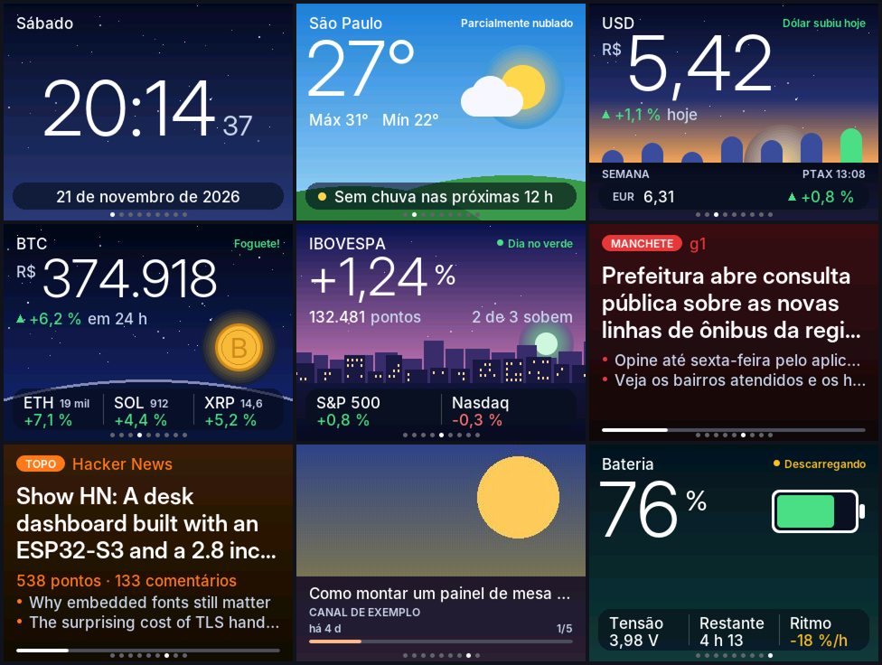

# Painel de mesa ESP32-S3 (ES3C28P 2.8")

Firmware para o módulo **ES3C28P** (ESP32-S3 + tela IPS 2.8" 240x320 com toque capacitivo) que mostra, em telas cheias que se alternam:

| Tela | Conteúdo | Fonte dos dados |
|---|---|---|
| Relógio | Hora, dia da semana, data completa com ano e estação | NTP |
| Clima | Temperatura, máxima/mínima, condição e chuva nas próximas 12 h | Open-Meteo |
| Dólar | Cotação PTAX, variação do dia, barras da semana e euro | Banco Central (PTAX) |
| Cripto | Preço e variação em 24 h (até 4 moedas) | CoinGecko |
| Bolsa | Ibovespa, S&P 500 e Nasdaq (ou ações) | Yahoo Finance |
| Jogo do time | Placar, tempo de jogo e outros jogos da rodada | ESPN |
| Notícias | Manchete e duas chamadas seguintes | RSS (g1 por padrão) |
| Hacker News | Histórias do topo, pontos e comentários | API do Hacker News |
| YouTube | Vídeos recentes do canal: miniatura, título e idade | RSS do canal |
| Radar | Aeronaves ao redor, com voo, modelo, distância e altitude | adsb.lol |
| Repositório | Estrelas, PRs e issues abertos, último CI | API do GitHub |
| Bateria | Carga, tensão, tempo restante e ritmo de carga ou descarga | ADC do módulo |

Nenhuma das fontes exige chave de API.



## Como usar

1. Instale o [PlatformIO](https://platformio.org/install) (extensão do VS Code ou `pip install platformio`).
2. Ajuste cidade, moedas, ações, feed e telas em `include/app_config.h`.
3. Conecte o módulo pela USB-C e grave:

```bash
pio run -t upload
```

4. Na primeira vez, a tela lista as redes Wi-Fi (2.4 GHz): toque na sua, digite a senha no teclado e confirme em **OK**. A rede fica gravada na placa.

Para trocar de rede depois, segure o botão **BOOT** por 2 segundos.

Se a porta não aparecer, entre em modo de gravação: segure **BOOT**, pressione e solte **RESET**, solte **BOOT**.

**Navegação:** as telas trocam sozinhas a cada 15 s. Toque no terço esquerdo para voltar; no restante da tela (ou um toque curto no botão BOOT) para avançar.

## Configuração (`include/app_config.h`)

| Constante | Função |
|---|---|
| `kScreens` | Telas exibidas e a ordem |
| `kScreenRotationSeconds` | Tempo por tela (`0` = só pelo toque) |
| `kDisplayRotation`, `kBrightness` | Orientação (1 ou 3) e brilho |
| `kDetectLocation` | Detecta cidade e fuso horário pelo endereço de rede (ipwho.is) |
| `kCityName`, `kLatitude`, `kLongitude` | Local usado se a detecção estiver desligada ou falhar |
| `kTimezone`, `kSouthernHemisphere` | Fuso horário de reserva e estação do ano |
| `kCoins`, `kCryptoCurrency` | Moedas da tela Cripto |
| `kStocks` | Ativos da tela Bolsa (ações da B3 terminam em `.SA`) |
| `kLeagueCode`, `kLeagueName`, `kFavoriteTeam` | Campeonato e time em destaque |
| `kNewsFeedUrl`, `kNewsSource` | Feed RSS de notícias |
| `kYoutubeChannelId` | Canal do YouTube; **vazio desativa a tela** |
| `kRadarRadiusKm` | Raio do radar em torno de `kLatitude`/`kLongitude` |
| `kGithubRepo` | Repositório público acompanhado |
| `kBatteryDividerRatio` | Calibração da leitura de tensão da bateria |
| `k...IntervalMs` | Intervalos de atualização |

## Estrutura

```
include/
  app_config.h          ajustes do painel
  board_pins.h          pinagem do módulo
  secrets.example.h     opcional: rede padrão para placas sem toque (ES3N28P)
src/
  main.cpp              inicialização, tarefa de rede e laço de desenho
  display/              configuração do display, toque e backlight (LovyanGFX)
  power/                leitura e estimativa da bateria
  net/                  configuração do Wi-Fi pela tela e credenciais gravadas na placa
  data/                 HTTP, serviços (busca) e parsers (interpretação) de cada fonte
  model/                estruturas de dados compartilhadas
  ui/                   telas, componentes, tema e fontes embutidas
tools/
  generate_fonts.py     gera as fontes (Inter) embutidas em src/ui/fonts
  simulator/            renderiza as telas no PC e gera docs/preview
  test_parsers.cpp      testa os parsers no PC
docs/
  hardware.md           resumo do manual e mapa de pinos
```

**Funcionamento:** a rede roda em uma tarefa separada (núcleo 0) e publica os dados em um estado protegido por mutex; o laço principal desenha a tela inteira em um buffer na PSRAM e envia ao display de uma vez, sem piscar. Quando uma atualização falha, o último dado válido permanece e a busca é repetida em 30 s.

## Ferramentas de desenvolvimento

Depois do primeiro `pio run` (que baixa as bibliotecas):

```bash
tools/simulator/build_preview.sh
```

```bash
g++ -std=c++17 -I.pio/libdeps/es3c28p/ArduinoJson/src -Isrc tools/test_parsers.cpp src/data/*_parsers.cpp -o .pio/test_parsers && .pio/test_parsers
```

O teste de parsers aceita uma pasta com respostas reais salvas (nomes dos arquivos no início de `tools/test_parsers.cpp`).

## Limitações conhecidas

- As conexões HTTPS não validam o certificado do servidor (dados públicos, somente leitura).
- A PTAX só é publicada em dias úteis; fora do pregão a tela mostra o último boletim.
- A tela do YouTube mostra os vídeos recentes do canal; reproduzir vídeo não é viável neste hardware.
- Emojis em títulos são omitidos (a fonte cobre o alfabeto latino com acentos).
- A API do GitHub sem token aceita 60 consultas por hora por IP; a tela Repositório usa 18.
- A bateria é estimada só pela tensão: o módulo não tem sinal de "carregando" nem medidor de corrente. A porcentagem fica um pouco alta durante a carga, e o tempo restante aparece depois de alguns minutos de leitura.

## Apps que dependem de um computador ou de conta

Estas telas da loja de referência não foram incluídas porque os dados não estão em uma API pública que o ESP32 alcance sozinho:

| App | Motivo |
|---|---|
| Meu computador, Docker, Notificações, Planos, Project Genesis, Tocando agora | Os dados vivem no computador; exigem um programa auxiliar enviando-os pela rede |
| Agenda | Exige login (Google/Microsoft) ou leitura completa de arquivos `.ics` com eventos recorrentes |
| Encomendas, Ordo, beeRota Clima | Dependem de serviços de terceiros sem API pública documentada ou de conta própria |
